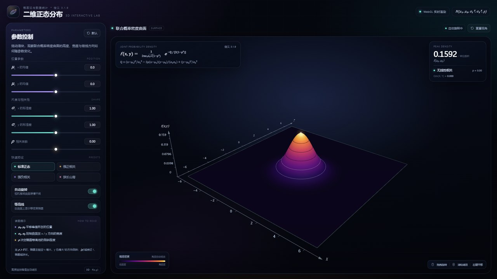

# Probability Visualization · 概率论可视化

两个可以动手的交互式概率论网页。都是单文件 HTML，打开即用，不需要安装、服务器或联网。

| 01 · 协方差实验室 | 02 · 二维正态分布 |
| --- | --- |
| [](covariance/index.html) | [](bivariate-normal/index.html) |
| 拖动散点，理解“两个变量是不是在一起波动”。 | 旋转 3D 曲面，观察联合概率密度与参数的关系。 |

## 在线访问

- 合集首页：<https://hubyuan30.github.io/probability-visualization/>
- 协方差实验室：<https://hubyuan30.github.io/probability-visualization/covariance/>
- 二维正态分布：<https://hubyuan30.github.io/probability-visualization/bivariate-normal/>

也可以把仓库下载到本地，直接双击 `index.html`，所有页面都能离线运行。

## 两个实验

### 01 · 协方差实验室

[进入页面](covariance/index.html)

- 拖动散点，实时观察协方差、相关系数，以及每个点对协方差的“投票”
- 正相关 / 负相关 / 几乎无关 / U 形陷阱四组预设
- 逐点累加演示，理解 `Cov(X,Y) = E[(X−EX)(Y−EY)]`
- ρ 与 σ 滑块，分清协方差和相关性的区别
- 公式解剖、常见误区与四道随堂自测

### 02 · 二维正态分布 · 3D 交互实验室

[进入页面](bivariate-normal/index.html)

- 三维曲面高度表示联合概率密度 `f(x,y)`，颜色由低到高采用 plasma 色带
- 鼠标拖拽旋转、滚轮缩放、右键平移，支持自动旋转
- `μ₁, μ₂, σ₁, σ₂, ρ` 五个参数实时调节
- 曲面上显示等密度椭圆，右侧实时显示峰值密度与协方差
- 标准正态、强正相关、强负相关、狭长山脊四组预设

## 打开方式

直接双击根目录的 `index.html` 进入合集首页，再选择任意实验；也可以直接双击：

- `covariance/index.html`
- `bivariate-normal/index.html`

所有页面均无外部 CDN 请求。二维正态页面已把 Three.js 内联进 HTML，离线也能正常渲染。

## 目录结构

```text
.
├─ index.html                  # 合集入口页
├─ assets/                     # 入口页配图
├─ covariance/
│  ├─ index.html               # 协方差实验室（成品）
│  ├─ src/                     # shell.html + style.css + app.js
│  ├─ build.mjs                # 内联构建脚本
│  ├─ package.json
│  └─ README.md
└─ bivariate-normal/
   ├─ index.html               # 二维正态分布（成品）
   ├─ src/                     # 页面模板 + Three.js 场景源码
   ├─ preview/                 # 桌面 / 笔记本 / 手机 / 参数偏移截图
   ├─ build.mjs                # 把打包 JS 内联回 HTML
   ├─ package.json
   └─ README.md
```

## 本地修改与构建

协方差页面不需要安装依赖：

```powershell
cd covariance
npm run build
```

二维正态页面需要先安装 `three` 与 `esbuild`：

```powershell
cd bivariate-normal
npm install
npm run build
```

两个构建脚本都会重新生成各自目录下的 `index.html`。

## 计算与读图说明

- **协方差**：页面使用总体形式 `1/n`，便于与 `E[·]` 对应；样本协方差通常使用 `1/(n−1)`，但不改变符号与直观含义。
- **二维正态曲面**：为了让不同参数下的曲面都保持可观察的高度，峰高采用自动归一化，但 z 轴刻度会同步显示真实的概率密度数值。

## 第三方许可

二维正态页面的 3D 渲染基于 [three.js](https://threejs.org/)，遵循 MIT License，Copyright © 2010-2025 three.js authors。其余代码以 MIT License 发布，详见 [LICENSE](LICENSE)。